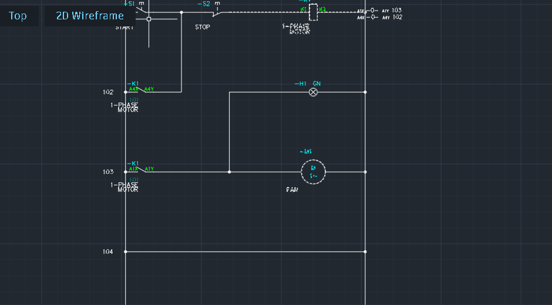
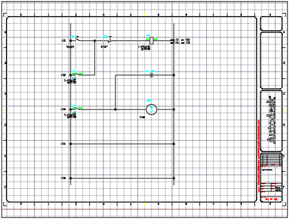
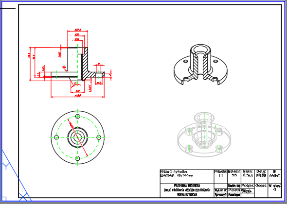

# AutoCAD Technical Drawings: Electrical Control Schematic and a Machine Part

A collection of **AutoCAD** drawings from my Engineering Graphics and electrical coursework at Warsaw University of Technology. It covers an electrical control schematic, plus a 2D technical drawing with dimensions, sections and a title block on an ISO A3 sheet, backed by a 3D solid model.

## 1. Motor control circuit (automatics)

| Schematic (detail) | Full sheet with title block |
|---|---|
|  |  |

A relay–contactor control circuit for a single-phase motor, drawn to electrical schematic conventions with numbered current paths and cross-referenced contacts:
- **START (S1)** and **STOP (S2)** push-buttons
- Contactor **K1** with a **self-holding (latching) contact**, so the motor keeps running after START is released
- **Indicator lamp H1** that lights while the contactor is energised
- **Single-phase fan motor M1**, switched by a K1 contact

**File:** `motor_control_automatics.dwg`

## 2. Revolved machine part (flange)

A full technical drawing of a rotationally symmetric flanged part on an ISO A3 sheet:
- Half-section front view with full dimensioning
- Top view showing the bolt-hole pattern on its pitch circle
- 3D solid model in both sectioned and hidden-line views
- Standard title block (scale, material, mass)

**File:** `revolved_part_A3.dwg` (3D model plus A3 and A4 layouts)

## How to open

Open the `.dwg` files in **AutoCAD** (2018 or newer), the free **[AutoCAD Web](https://web.autocad.com)** viewer, or **Autodesk Viewer**. Switch to the layout tabs (*Arkusz A3 / A4*) to see the plotted sheets.

## Skills

AutoCAD · AutoCAD Electrical conventions · Technical drawing (ISO) · Dimensioning · Sections and views · 3D solid modelling · Layouts and title blocks · Relay–contactor control circuits

## Author

**Nurmukhammed Polat**, Electrical Engineering, Warsaw University of Technology
[LinkedIn](https://www.linkedin.com/in/nurmukhammed-polat-6a6677251/)
